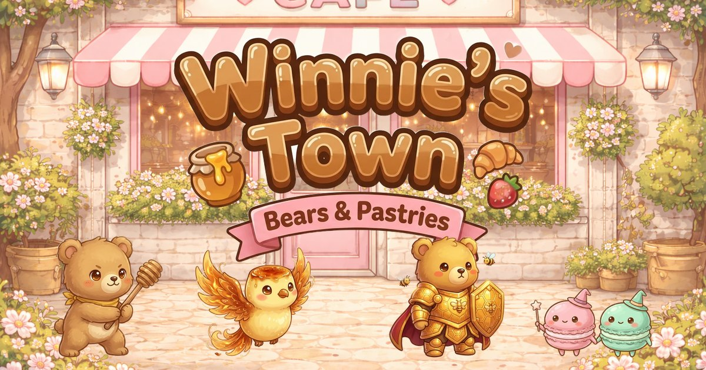

# Winnie's Town — Bears & Pastries

A cosy café game of cute 3v3 battles. Collect Bears and Pastries across five rarities, build a team of three, battle your way across town, and decorate Winnie's café so it earns honey while you're away.



## Play

It's a static site with no build step.

```bash
npm start            # serves on http://localhost:8080 (python3 http.server)
npm test             # battle engine + summon tests (Node 22)
```

**Publishing:** push to `main` and `.github/workflows/pages.yml` deploys to GitHub Pages. Turn it on once in *Settings → Pages → Source: GitHub Actions*. Any static host also works (Netlify, Vercel, itch.io as an HTML5 game): upload the repo root.

## The game loop

| Screen | What you do |
| --- | --- |
| **Storefront** | Title screen. Tap *Enter*. |
| **Café** (hub) | Winnie gives a daily treat (100 heartstones + 150 honey). The tip jar fills with honey over time, faster with more charm. Customers show up as the café gets cosier. |
| **Map** | 9 locations × 3 battles. Clearing a location's boss unlocks the next one. Earn up to 3 stars per battle by winning without losing anyone. |
| **Battle** | 3v3, turn order set by speed. Tap an enemy to target it, then **Attack** or use your **Skill** (it has a cooldown). Auto battle and 1×/2×/3× speed. |
| **Team Manager** | Pick 3 friends, read their stats and skills, and level them up with honey treats. *Auto* picks your strongest team. |
| **Shop** | The **Wishing Oven** summons friends (100 heartstones, or 900 for ten with an Epic or better guaranteed). The **Café Decor** tab sells furniture and treats. |
| **Decorate** | Place decor on four counter spots and two floor spots. Each piece adds charm. |
| **Camera** | The photo album: every friend in town, with silhouettes for the ones you haven't met yet. |

### Rarities

| Rarity | Summon rate | Stat multiplier | Friends |
| --- | --- | --- | --- |
| Common | 52% | ×1.00 | Honey Cub, Cocoa Cub, Crumbly Croissant, Mochi Puff |
| Rare | 30% | ×1.18 | Maple Scout, Berry Medic, Macaron Twins, Cinnamon Healer |
| Epic | 13% | ×1.40 | Panda Ronin, Polar Barista, Éclair Duelist, Duchess Shortcake |
| Legendary | 4.2% | ×1.70 | Sir Bumble, Gâteau Golem |
| Mythic | 0.8% | ×2.05 | Aurora, Crème Phoenix |

A Legendary or better is guaranteed within 40 summons. Duplicates add a star (+10% stats each, up to 5★); after that they turn into honey.

### Combat

- **Roles:** Tanks taunt and shield, Strikers hit one target hard, Mages hit the whole enemy team, Supports heal and buff.
- **Statuses:** Taunt, Slow, Frozen (lose a turn), Burn (damage over time), ATK Up.
- **Synergy:** 3 Bears give *Hibernation Hug* (+15% HP), 3 Pastries give *Sugar Rush* (+15% ATK), and a mixed team gets *Café Friends* (+8% speed).
- **Overtime:** after turn 60, damage ramps up so tank-vs-tank stalemates always end.
- The Crème Phoenix comes back once at 40% HP after being defeated.

## Project layout

```
index.html              entry point (the other *.html files are deep links into scenes)
css/style.css           page shell, letterbox backdrop, rotate-device hint
js/data.js              rarities, roster, skills, stages, decor (plain data)
js/battle-engine.js     turn order, damage, skills, statuses, AI (no Phaser, runs in Node)
js/save.js              localStorage save, summoning, levelling, café income
js/audio.js             synthesised music-box loop + sound effects (Web Audio, no files)
js/ui.js                Phaser UI kit: panels, buttons, rarity cards, modals, top bar
js/scenes/*.js          Boot, Title, Café, Map, Battle, Team, Shop, Decorate, Album
tests/engine.test.js    battle and summon tests
assets/units|arenas|ui  game-ready WebP art
assets/opt/             web-sized copies of the original art; full-size sources stay in assets/*
```

The game renders at 1280×720 and scales to fit any screen. On phones held upright it asks you to rotate.

## Art

The original café, map, decor, UI and NPC art lives in `assets/scene`, `assets/decor`, `assets/icons`, `assets/backgrounds` and `assets/characters`. The 16 fighters, 7 battle arenas, the logo, the Wishing Oven and the role and faction badges were generated with Higgsfield (Nano Banana Pro), using the existing bear and panda art as style references, and their backgrounds were removed with Higgsfield's background remover.
